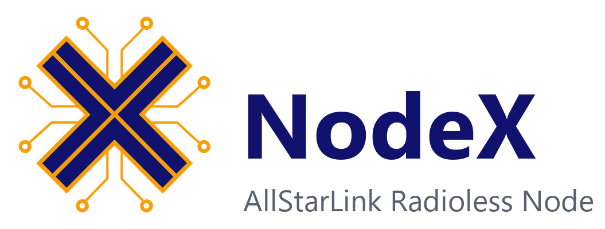

<p align="center">
  <picture>
    <source media="(prefers-color-scheme: dark)" srcset="branding/exports/nodex-lockup-dark.png">
    
  </picture>
</p>

<p align="center"><b>An AllStarLink node for your phone or computer. No Asterisk, no radio, no hardware.</b></p>

<p align="center">
  <a href="https://github.com/Russell-KV4S/NodeX/actions/workflows/ci.yml"></a>
  <a href="LICENSE"></a>
</p>

NodeX is a standalone [AllStarLink](https://www.allstarlink.org/) (ASL) node written in C# (.NET 10, Avalonia UI). It is a real peer node on the ASL network, speaking IAX2 over UDP and registering over HTTPS. It is **not** a WebTransceiver or a guest softphone. Audio comes from your device's microphone and speaker, or from a Bluetooth headset or speaker-mic whose button acts as push-to-talk.

It is built for a **portable node**: register once, link out to other nodes, and stay connected while the screen is off and while you move between Wi-Fi and cellular.

## Features

- **Multi-node linking:** register once with AllStarLink and hold up to **8 simultaneous outbound links** with live mixed audio, per-node mute, and a single explicit transmit target
- **Android Auto integration:** browse linked nodes and favourites, switch listen/transmit focus, mute, and optionally transmit from the car screen or steering wheel (full GitHub edition)
- Find-a-node search, favourites with custom labels, and a DTMF keypad for node function codes (sent to the transmit node; Link/Unlink use the Connect box's node)
- Push-to-talk: on-screen (momentary or toggle), Bluetooth LE button with a "Learn" wizard, and headset media key
- Auto-reconnect and seamless Wi-Fi ↔ cellular network handoff
- Optional station-ID reminder (it never transmits for you)
- Full Android edition: GitHub update checks and a verified download/install flow
- Passwords kept in the platform secret store; no telemetry
- Dark, Light and High contrast themes, with text size from 100% to 150%
- Permission explanations in Settings, with Android permission review and a Not now option

## Connect to multiple nodes at once

NodeX is built for monitoring and operating across more than one repeater, hub, or net at the same time:

- **Up to 8 simultaneous links:** stay connected to up to 8 outbound nodes at once, each with its own connection, independent auto-reconnect, live audio, per-node **Mute / Unmute**, and **Disconnect**.
- **Safe single transmit node:** your first connected node becomes the transmit target; every other linked node stays **listen-only** until you explicitly tap **Transmit here** on another card.
- **No accidental RF routing:** if your active transmit node drops from the far end, NodeX clears the transmit target rather than silently moving your mic to another connected node, and NodeX never cross-links or repeats audio between connected nodes.
- **Live activity:** per-node talking indicators and parsed ASL status/link lists show which linked node is active.

## Android Auto integration

Take your AllStarLink node on the road as a native Android Auto media app:

- **Browse & dial safely:** switch between **Active Links** and **Favourites** tabs on your car display, tap a favourite to dial, or select any active link to focus it on Now Playing.
- **Clear car controls:** Now Playing shows who is talking, your link count, and whether you are listening or armed to transmit, with per-node **Transmit here**, **Mute / Unmute**, and **Disconnect** buttons.
- **Car-safe media buttons:** **Next / Back** step through connected nodes without dialling new ones, **Pause / Stop** mute audio instead of dropping your links, and **Play** unmutes. Any active car transmission is immediately released if focus is lost, the car disconnects, or any media button is pressed.
- **Play vs full GitHub edition:** the Google Play edition is **listen-only** in the car (you can still browse, switch nodes, mute, and disconnect). The full GitHub APK edition (`NodeX-android.apk`) adds an optional **Talk** screen button and optional steering-wheel **Next** or **Back** PTT trigger in **Settings** (disabled by default, with audible key/unkey confirmation tones and a car transmission time limit).

## Platforms and status

NodeX is young. This table says what has actually been tested.

| Platform | Status |
|---|---|
| **Windows** | Works. Core protocol validated live against a real ASL3 node. |
| **Android** | On Google Play internal testing; used on a real phone. Background behaviour, Bluetooth PTT and network handoff are still being tested on devices. |
| **Android Auto** | Earlier DHU use succeeded. The latest Play report found missing PTT (disabled in that edition) and an icon regression, fixed in 1.16 but awaiting a car check. Individual voice/focus/cold-start cases still need recording. |
| **Linux / macOS** | Audio backend written (PortAudio); tested only with a small test program on a Raspberry Pi. The full app has not been run there. |
| **iOS** | Compiles. Never run on a device; no release planned. See [`docs/IOS_RELEASE.md`](docs/IOS_RELEASE.md) if you want to pick it up. |

Details of what is and is not verified are in [`docs/LIVE_VALIDATION.md`](docs/LIVE_VALIDATION.md) and §2 and §14 of [`PROJECT_SPEC.md`](PROJECT_SPEC.md).

## Amateur radio and licensing

Many ASL nodes key real radio transmitters. **Transmitting through NodeX is amateur-radio transmission. You need a valid amateur licence to transmit, and you are responsible for identifying yourself as your licence requires.** NodeX does not ask for or verify your callsign and never sends an automatic ID or any audio of its own; the ID reminder only prompts you. Using NodeX needs an AllStarLink account with a node number and node password.

Respect node owners' linking policies. Don't test by keying a node you don't control without its owner's knowledge.

## Getting started

You need an AllStarLink account and a registered node number and password (from the [ASL portal](https://www.allstarlink.org/)). Enter them on the first-run screen.

**Downloads:** [GitHub Releases](https://github.com/Russell-KV4S/NodeX/releases) provide the full Android APK and self-contained Windows, Linux and macOS packages for x64 and ARM64. iOS is excluded. Releases are currently private, so repository access is required. See each release's installation notes and [`docs/RELEASING.md`](docs/RELEASING.md).

For Android Auto PTT, use `NodeX-android.apk`, then enable Talk from the car and choose a wheel button in Settings. The Play edition omits car PTT. Switching from Play may require uninstalling because the signing keys differ; export settings first and be prepared to re-enter your node password. Future same-key sideload updates preserve app data. The full edition has Settings → App updates; in-app delivery remains unavailable while releases are private, so download through GitHub manually for now.

**Build from source** (needs the [.NET 10 SDK](https://dotnet.microsoft.com/download); see `global.json`):

```bash
dotnet build src/NodeX.UI/NodeX.UI.Desktop      # core, UI and desktop app
dotnet test  tests/NodeX.Core.Tests             # unit tests
dotnet test  tests/NodeX.UI.Tests               # headless UI and rendering tests
dotnet run   --project src/NodeX.UI/NodeX.UI.Desktop
```

The Android head additionally needs the .NET `android` workload (`dotnet build src/NodeX.UI/NodeX.UI.Android`). Android signing keys are excluded from the repo; release automation uses encrypted Actions secrets. Shared desktop/Android version numbers live in `Directory.Build.props`.

Build output is redirected to `%LOCALAPPDATA%\NodeX\build` by `Directory.Build.props` (set `NODEX_BUILD_ROOT` to change it). On Linux you also need `libjack-jackd2-0` and ALSA libraries for sound; without them NodeX runs silently.

## Known limitations

- Outbound links only. Cellular carriers block inbound IAX2, so NodeX ignores inbound links.
- A hub can refuse your link for some minutes after you register or change network, until it has learned your node's address. NodeX keeps retrying (up to about 28 minutes).
- Moving between Wi-Fi and cellular drops and re-dials the link (an IAX2 call cannot change address). It works in day-to-day use, with a delay while the new address registers; the delay has not been measured.
- IPv4 only.
- Linux and macOS use the OS keyring (`secret-tool` / `libsecret` on Linux, Keychain on macOS) when available, falling back to a `0600` key file beside the ciphertext on minimal/headless systems without a keyring daemon.
- Desktop BLE uses the existing Scan / Learn setup on Windows and glibc Linux (x64/ARM64), and macOS 15+ on Apple Silicon. It needs an enabled adapter; Linux also needs BlueZ/D-Bus. Real-button validation is still needed. Intel Macs and older macOS are unsupported by the bundled BLE library.

Outbound calls use an available local UDP source port. This does not restrict the remote node's destination port; nonstandard remote ports are looked up independently.

## Documentation

- [`PROJECT_SPEC.md`](PROJECT_SPEC.md): architecture, protocol facts, behaviour reference, backlog
- [`docs/LIVE_VALIDATION.md`](docs/LIVE_VALIDATION.md): results from tests against real nodes
- [`CONTRIBUTING.md`](CONTRIBUTING.md) and [`SECURITY.md`](SECURITY.md)

## Credits

Built with [Avalonia](https://avaloniaui.net/), [CommunityToolkit.Mvvm](https://github.com/CommunityToolkit/dotnet), [NAudio](https://github.com/naudio/NAudio) and [PortAudioSharp2](https://github.com/k2-fsa/portaudiosharp2). Protocol details come from RFC 5456 and the AllStarLink `app_rpt` source. NodeX is an independent project and is not affiliated with or endorsed by AllStarLink.

## License

[MIT](LICENSE) © Russell Thomas (KV4S)

NodeX source is MIT licensed. Desktop BLE includes SimpleSharpBLE/SimpleBLE under a separate noncommercial-use license; see [third-party notices](THIRD_PARTY_NOTICES.md).
